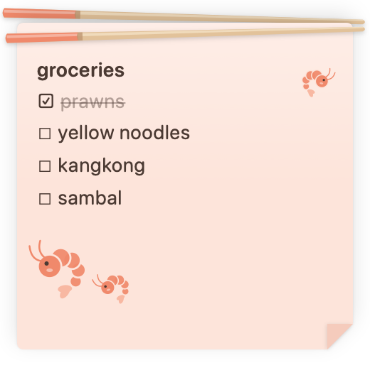
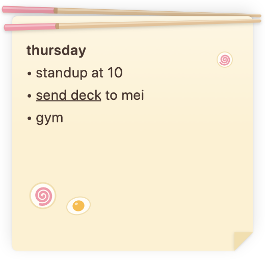
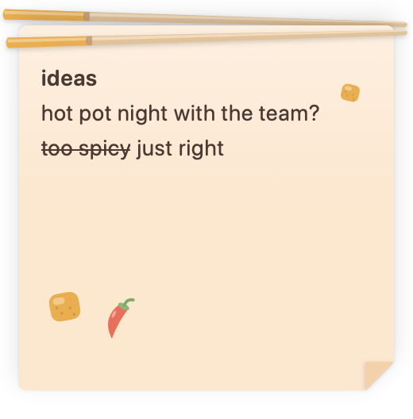
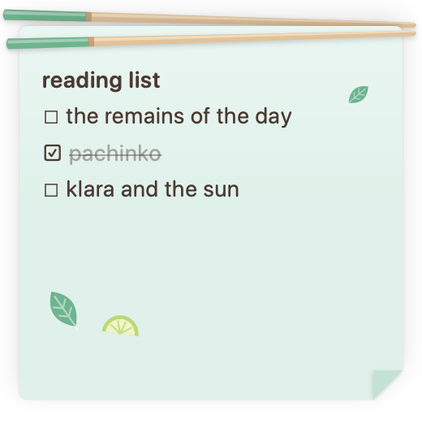
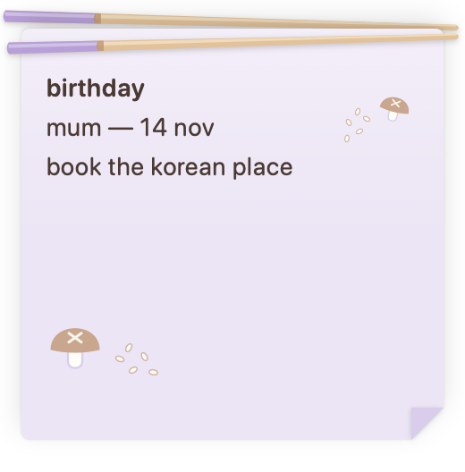
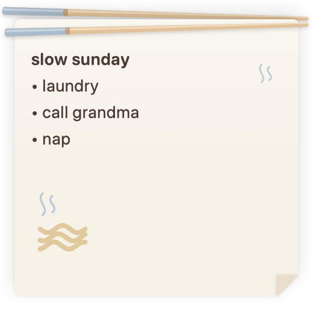
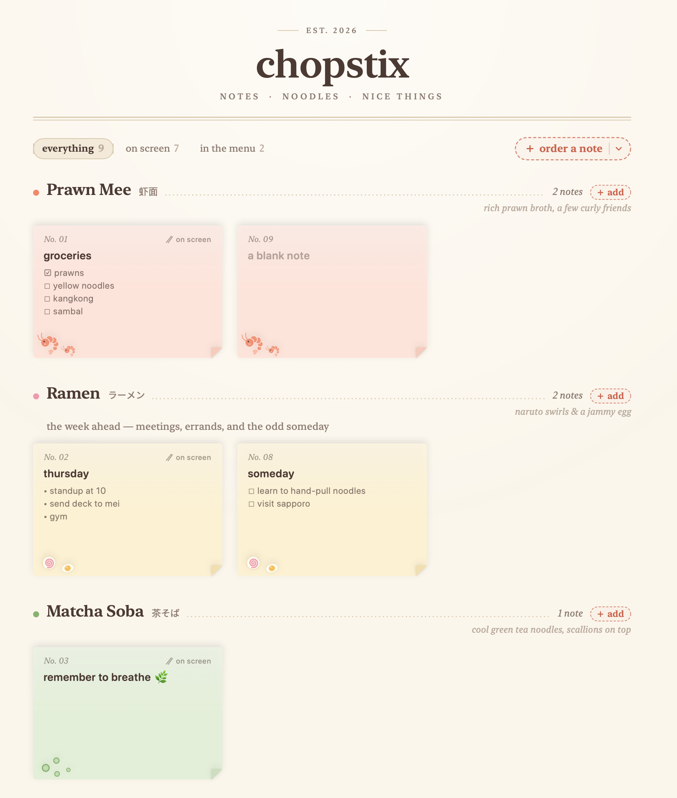
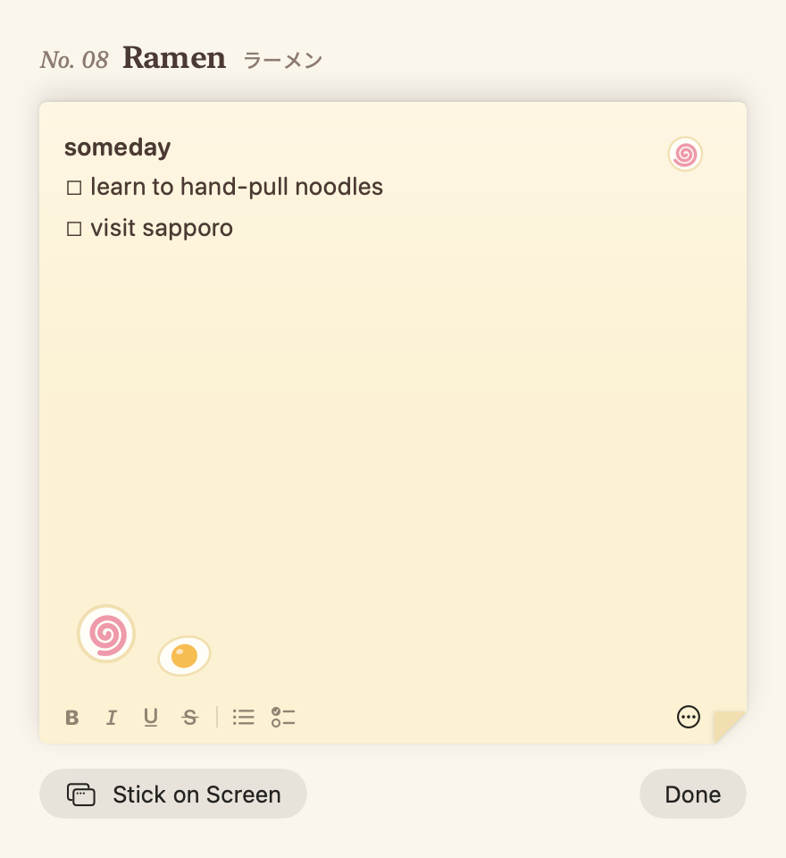
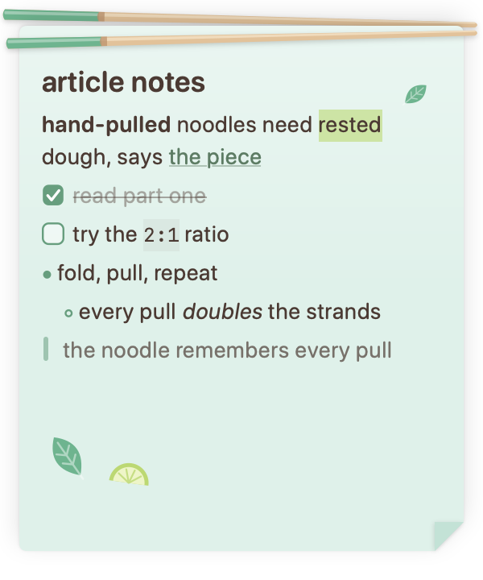
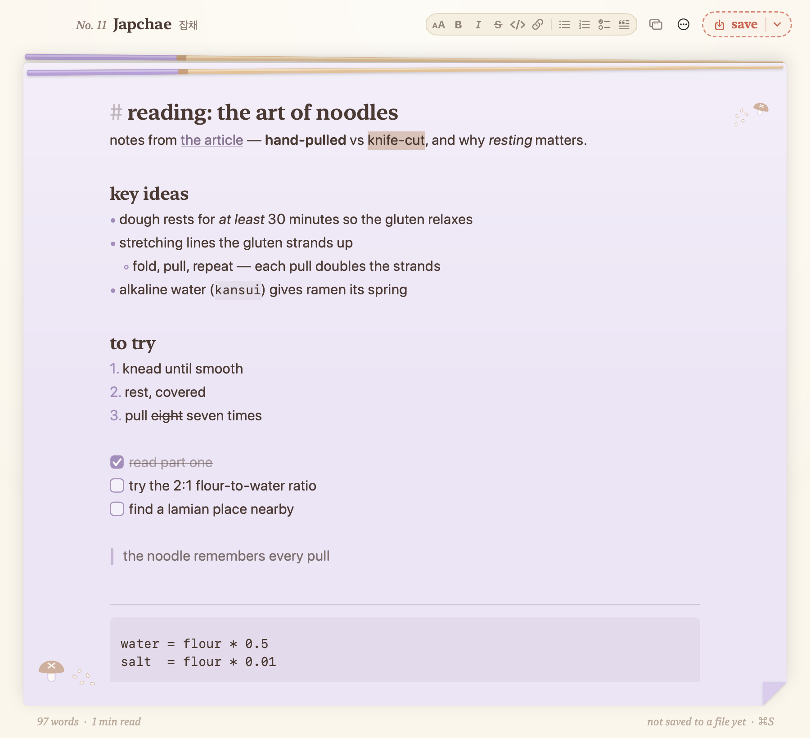

# chopstix 🥢

A cute, simple sticky-note app for macOS. Each note is a bowl of noodles held up on your
screen by a pair of chopsticks; all of them live on a menu-style board.

<p align="center">
  
  
  
  
  <br>
  
  
  
</p>

| The menu board | Editing a note in the board |
| :---: | :---: |
|  |  |

### Markdown notes

For longer notes — say, beside an article you're reading — a markdown note renders as you
type and tucks its syntax away off the line you're on. Open it as a full page to write with
more room, then save it as a `.md` file or export a PDF.

| A markdown sticky note | Opened as a page |
| :---: | :---: |
|  |  |

Screenshots are rendered straight from the SwiftUI views with
`swift run Chopstix --snapshot <dir>` (sample notes, your real notes are untouched).

## Build & run

Requires macOS 14+ and the Swift 6 toolchain (Xcode or just the Command Line Tools).

```sh
scripts/build_app.sh            # → build/Chopstix.app
open build/Chopstix.app
scripts/build_app.sh --install  # copy to /Applications

swift run Chopstix              # quick dev run, no bundle
scripts/test.sh                 # unit tests
swift run Chopstix --snapshot /tmp/chopstix-snaps   # render the design to PNGs
```

Notes are stored in `~/Library/Application Support/Chopstix/` (override with
`CHOPSTIX_DATA_DIR=/some/dir`): `notes.json` is the index, each markdown note's text is a
plain `markdown/<id>.md` file, and `notes.backup.json` is the last index that loaded cleanly.

## Using it

| | |
| --- | --- |
| New sticky note | ⌘N, the menu-bar chopsticks, or **order a note** on the board |
| New note that stays in the board | ⇧⌘N |
| Show the board | ⌘0, or click the Dock icon |
| Move a note | drag the chopsticks / top edge |
| Resize a note | drag the folded bottom-right corner |
| Put a note back in the board | ⌘W, or ⋯ → Return to Menu Board |
| Bold / italic / underline / strikethrough | ⌘B / ⌘I / ⌘U / ⇧⌘X |
| Bulleted list / checklist | ⇧⌘7 / ⇧⌘L — Return continues the list, Return on an empty item ends it |
| Tick a box | click it |
| Flavour, always on top, delete | hover a note → ⋯ |
| New markdown note | ⌥⌘N, or **order a note ▾** |
| Markdown blocks | type `/` on an empty line — headings, lists, to-dos, quote, code, divider |
| Markdown formatting | ⌘B ⌘I ⇧⌘X, ⌘E code, ⇧⌘H highlight, ⌘K link, ⌥⌘1–3 headings, ⇧⌘9 numbered list |
| Nest a list item | Tab / ⇧Tab; Return on an empty item un-nests it, then ends the list |
| Open a link | ⌘-click it (paste a URL over selected text to link it) |
| Open as a page | ⌥⌘↩ or ⤢ on the note; clicking a markdown note in the board |
| Save as `.md` / export PDF | ⌘S (saves again to the same file) · ⇧⌘S · ⇧⌘E |
| Turn a sticky note into markdown | ⋯ → Convert to Markdown Note… |

Flavours: Prawn Mee, Ramen, Matcha Soba, Laksa, Pho, Japchae, Udon.
